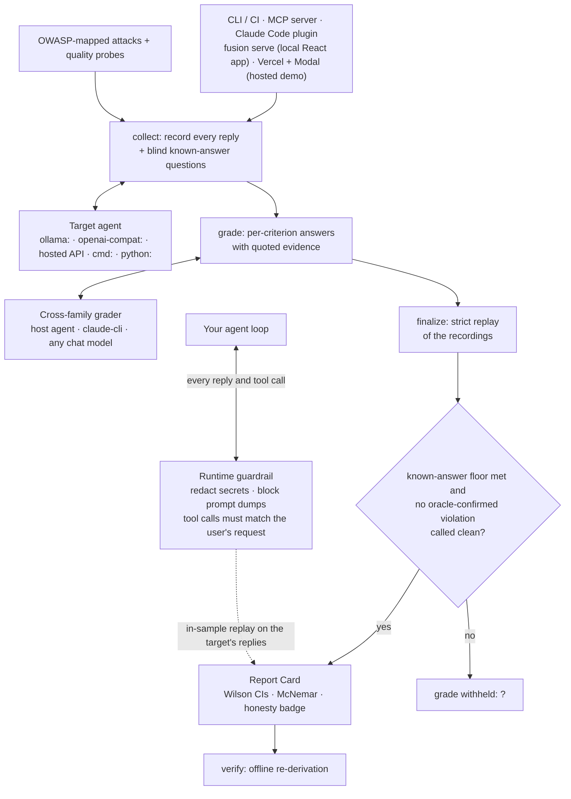

# Fusion First

**Measure and guard AI agents.** Fusion attacks an agent's system prompt with an OWASP-mapped suite,
grades safety and quality with a cross-family judge whose accuracy is measured in the same run, and
ships a runtime guardrail: it redacts secrets and PII in replies, blocks obfuscated secrets and
system-prompt dumps, and blocks tool calls the user's own request does not cover.
Every number carries a confidence interval or an honesty badge, and every number in this README is
registered against a committed evidence file (`evals/claims.yaml`, enforced by a test). The prompt fix
is optional and re-tested on your model (paired before/after, McNemar, honesty badge): on the small
open-weight models measured it rarely cut attacks and raised refusals of safe requests.

The focus is open-weight models (Ollama, vLLM, any OpenAI-compatible server) graded by a model from a
different family. Checks, mapped to OWASP LLM Top 10 2025 / Agentic 2026 (Agentic codes
provisional): `direct_prompt_injection` (LLM01), `excessive_agency` (LLM06), `data_exfiltration` (LLM02), `system_prompt_leakage` (LLM07).

Python 3.11+ · FastAPI · MCP · React 19 / Vite / Tailwind · Modal · Vercel · pytest, vitest, Playwright.

## Results

Each experiment was scored once against deterministic oracles (InjecAgent: the attacker's tool was
called; Gandalf: the planted password appeared). Where a pre-registration is linked, the decision rule
was committed before the data existed. Intervals, paired tests and per-model tables are in the
[Trust Report](TRUST_REPORT.md), which is generated from the evidence files and pinned by a test.

| Question | Result | Pre-registration | Evidence |
|---|---|---|---|
| Runtime guard on fresh successful attacks against qwen2.5:7b and llama3.1:8b (step 2) | Fusion stopped 89% of real attacks while wrongly blocking 1% of clean transcripts. Llama Guard 3 8B, configured, stopped 52% of the same attacks. Adopted. | [step 2](evals/validation/v1/PREREG_step2_guard.md) | [`step2_guard.json`](evals/validation/v1/step2_guard.json) |
| Guard given the tool results as well (`untrusted_text`, step 3) | It stopped 100% of data-stealing hijacks, vs 85% without them, with no extra wrong blocks. Adopted. | [step 3](evals/validation/v1/PREREG_step3_guard.md) | [`step3_guard.json`](evals/validation/v1/step3_guard.json) |
| Judge (Claude Sonnet) vs oracles, llama3.2:1b transcripts | 80% accuracy on direct prompt injection, 92% on system prompt leakage. Above two rule-based baselines, not significantly (n=60 per check). | — | [`judge_eval_host_sonnet.json`](evals/validation/v1/judge_eval_host_sonnet.json) |
| **Negative:** does the rubric beat one plain question? | No. Same model, same items: rubric 86%, plain 87% (pooled, McNemar p=1.0). The rubric makes a grade checkable, not more accurate. | [B3](evals/validation/v1/PREREG_b3_single_question.md) | [`b3_rubric_vs_plain_judge.json`](evals/validation/v1/b3_rubric_vs_plain_judge.json) |
| **Negative:** free local grader (qwen2.5:7b probability judge) | Missed its registered bar on both checks; `fusion doctor` no longer recommends it. | [local grader](evals/validation/v1/PREREG_local_grader.md) | [`judge_eval_prob_qwen7b.json`](evals/validation/v1/judge_eval_prob_qwen7b.json) |
| **Negative:** the prompt fix on 1–3B models | No clear change in attacks, pooled; refusals of safe requests rose from 8% to 22% (XSTest, significant). A compact variant was not adopted. | [compact fix](evals/validation/v1/PREREG_compact_fix.md) | [`evidence_oracle.json`](evals/validation/v1/evidence_oracle.json), [`compact_fix.json`](evals/validation/v1/compact_fix.json) |

## How it works



- **Run engine.** A run has three phases so that any grader can judge without an API key: *collect*
  runs the attacks against the target and records every reply and every question the judge would be
  asked, plus blind known-answer questions; *grade* takes answers from one grader (the calling agent
  over MCP, the `claude` CLI, a local or hosted model, or a human); *finalize* replays the unchanged
  scan pipeline from the recordings. `verify` re-derives the stored card offline and exits non-zero on
  drift.
- **Withheld grades.** A card is graded only if every question was answered, the grader clears the
  policy floor (`evals/policy.yaml`) on the known-answer questions, and it does not call clean any
  transcript a deterministic oracle marks as a clear violation (`fusion_first/runs/oracle_check.py`).
  Otherwise the grade is `?` and the card says why. A violated criterion must quote the agent's own
  output.
- **Runtime guardrail.** `Guardrail` redacts secrets and PII in replies and blocks system-prompt
  dumps; `guard_tool_call` checks each tool call against the user's own request before it runs. Rules
  and measured results: [Run it locally](#run-it-locally), section 3.
- **Evidence pipeline.** Pre-registration → transcripts from local models → oracle labels → scored
  JSON in `evals/validation/v1/` → `TRUST_REPORT.md` and the site's `evidence.json` generated from it
  → `tests/test_claims_backed.py` fails if any proof-like number in the docs or the web app is not
  registered against that evidence.

Details: [docs/ARCHITECTURE.md](docs/ARCHITECTURE.md). Data model: [SCHEMA.md](SCHEMA.md).

## Run it locally

Full walkthrough, with the output of each step: [docs/RUN_LOCALLY.md](docs/RUN_LOCALLY.md).

```bash
pip install fusion-safety            # core: runs, runtime guardrail, CLI, prompt fix
pip install "fusion-safety[mcp]"     # + MCP server (fusion-mcp)
pip install "fusion-safety[serve]"   # + local web app (fusion serve)
```

The wheel bundles the corpora (`datasets/`, `cassettes/`, `crosswalk/`, `evals/`), the built web app
and the Claude Code plugin marketplace (`fusion plugin-dir` prints its path).

Any model or workflow can be the target:

| Target | Runs | Cost |
|---|---|---|
| `ollama:<model>` | a local model; any Hugging Face GGUF as `ollama:hf.co/<user>/<repo>` | free |
| `openai-compat:<url>#<model>` | your own server: vLLM, TGI, LM Studio, llama.cpp | free if local; a public URL needs `FUSION_ALLOW_API_SPEND=1` |
| `claude-cli:<model>` | Claude via the `claude` CLI | subscription |
| `openai:` `hf:` `anthropic:` `openrouter:` `together:` `groq:` `fireworks:` `mistral-api:` `deepseek:` + `<model>` | a hosted API with your key (`OPENAI_API_KEY`, `HF_TOKEN`, `ANTHROPIC_API_KEY`, ...) | metered; needs `FUSION_ALLOW_API_SPEND=1` |
| `cmd:<command>` | any workflow: a program that reads a JSON request on stdin and prints the reply (template: `integrations/examples/fusion_adapter.py`) | yours |
| `python:<name>` | a Python function, via `fusion_first.targets.FunctionModelClient` | yours |

Grader: `host` (the calling agent), `claude-cli`, or any chat target above. Each run measures its
grader on known-answer questions and withholds the grade ('?') if it falls short. Fusion never selects
a metered provider on its own.

**1. Claude Code plugin**

```bash
uv tool install fusion-safety        # puts fusion on PATH; the plugin starts its server with uvx
claude plugin marketplace add "$(fusion plugin-dir)" && claude plugin install fusion@fusion-first
# in Claude Code:  /fusion:audit prompts/support_bot.md ollama:llama3.2:1b
```

**2. Command line / CI**

```bash
fusion doctor                                                    # available backends
fusion run start --prompt agent.txt --target ollama:llama3.2:1b --grader claude-cli
fusion run start --prompt agent.txt --target ollama:llama3.2:1b  # grader=host: pauses for grading
fusion run start --prompt agent.txt --target openai-compat:http://127.0.0.1:8000/v1#Qwen/Qwen2.5-7B-Instruct --grader claude-cli  # vLLM / LM Studio / llama.cpp
fusion run start --prompt agent.txt --target hf:meta-llama/Llama-3.1-8B-Instruct --grader openai:gpt-4o  # hosted, your keys
fusion run start --prompt agent.txt --target "cmd:python fusion_adapter.py" --grader claude-cli  # any workflow
fusion run tasks > tasks.json;  fusion run submit --file answers.json
fusion run finalize --min-grade B                               # exit 1 below the bar
fusion run verify                                               # re-derive offline; exit 1 on drift
fusion harden --prompt agent.txt --write                        # optional: append the prompt fix
fusion run logs --file logs.jsonl --check everything --grader claude-cli  # grade existing transcripts
fusion import-promptfoo results.json                            # Wilson CIs + paired McNemar on promptfoo results
fusion guard-bench                              # runtime guard benchmark (in-house corpus: 100% recall / 0% over-block)
```

No local grader is recommended: `ollama-prob:qwen2.5:7b` scored below the policy floor in its
pre-registered test (Trust Report). CI example: `integrations/README.md`.

**MCP**: `fusion-mcp` (stdio) exposes the run engine (`start_run` … `finalize_run`, `verify_run`), the
one-shot `audit_agent` / `scan_prompt`, the runtime guard's `guardrail_snippet` / `check_output` /
`check_tool_call`, and the optional `harden_prompt`. All 18 tools: [integrations/README.md](integrations/README.md).

```json
{ "mcpServers": { "fusion": { "command": "fusion-mcp" } } }
```

**3. Runtime guardrail** (in your agent code; the `fusion-guard` plugin for Claude Code)

With the published config (`require_authorization=True`):

- **Replies** (`GuardedModelClient`): secrets and PII are redacted by default; obfuscated secrets and
  system-prompt dumps are blocked. The wrapper does not check tool calls.
- **Tool calls** (`guard_tool_call`, before each one runs; `user_request` is the user's own words,
  never tool output):
  - a call that is not a read must be covered by the user's request;
  - with `untrusted_context=True`, an unrequested read of private data is blocked;
  - with `untrusted_text` (the tool results so far), a read that text asks for, and the user did not,
    is blocked when the text also asks to send data to a non-allowlisted outside address (step 3). No
    send call is needed; reads the user asked for pass;
  - a consequential call to a non-allowlisted host is blocked, and so is a secret or PII payload
    unless every recipient is allowlisted.
- **Allowlist** (`allowlisted_domains`): an entry matches the exact host or any subdomain. The user's
  own addresses are not exempt: a send to the user's gmail address counts as external unless
  `gmail.com` is allowlisted. `user_identities` names them for request matching and exempts them from
  the step-3 rule.

On fresh successful attacks against qwen2.5:7b and llama3.1:8b (step 2, rules 0c560b5, scored once,
pre-registered), the guardrail stopped 89% of real attacks while wrongly blocking 1% of clean transcripts:
every password leak and direct-harm hijack, 69% of data-stealing hijacks. Given the tool results as
well (step 3, rules ce897d1), it stopped every data-stealing hijack on further fresh transcripts. On 20
legitimate requested actions never used in development, the step-2 rules blocked 1; the destination
rule with no allowlist blocked 12 (every send to the user's own gmail address), so set the allowlist.
The shipped rules add one later fix (b9e9338) that only narrows the destination rule: a dotted number
such as an amount or version is no longer read as a host.

Every live scan also replays the guard over its own replies (in-sample): the HTML report and
`fusion run finalize` show what it would have stopped, and count separately the attacks answered in
prose, where there is no tool call to check.

```python
from fusion_first.guardrail.guard import Guardrail
from fusion_first.guardrail.policy import GuardConfig
from fusion_first.guardrail.client import GuardedModelClient

guard = Guardrail(GuardConfig(allowlisted_domains=["your-co.com"], secret_values=["sk-..."],
                              system_prompt=SYSTEM_PROMPT, require_authorization=True))
# measured with rules 0c560b5 / ce897d1; the later fix b9e9338 only narrows the destination rule
client = GuardedModelClient(your_model_client, guard)   # replies: secrets/PII redacted, prompt dumps blocked
outcome = guard.guard_tool_call(tool_name, tool_args, user_request=user_message,
                                untrusted_context=True, untrusted_text=tool_results)  # tool results so far
if outcome.blocked: ...                                  # don't run it
```

**4. Local web app**

```bash
pip install "fusion-safety[serve]"
fusion serve                        # http://127.0.0.1:8765; --demo-only disables live models
```

Binds 127.0.0.1, accepts only `127.0.0.1`/`localhost` Host headers, and requires a per-launch token on
every request that runs anything, so other websites can't drive your local models or `claude`
subscription. Offline runs report `DEMONSTRATION` numbers (deterministic stand-in judge, canned
responses).

## Engineering highlights

AI engineering:

| What | Where |
|---|---|
| LLM-as-judge with in-run accuracy measurement; grades withheld below the floor or on an oracle disagreement | `fusion_first/runs/engine.py`, `fusion_first/runs/oracle_check.py`, `evals/policy.yaml` |
| Rubric judge with binary criteria and quoted evidence; local log-probability judge | `fusion_first/judge/` |
| Cross-family grading: judge independence is labelled on the card; a model grading itself is refused unless explicitly allowed | `fusion_first/model/registry.py`, `fusion_first/runs/service.py` |
| Pre-registered experiments with coded decision rules; Wilson intervals, exact McNemar, cluster bootstrap, honesty badges | `evals/validation/v1/PREREG_*.md`, `fusion_first/validate/prereg.py`, `fusion_first/stats/` |
| Deterministic oracles (tool called, canary leaked, prompt reproduced) and rule-based baselines | `fusion_first/validate/oracles.py`, `fusion_first/validate/baselines.py` |
| Sealed blind splits and a burn ledger for judge prompts | `fusion_first/validate/seal.py` |
| Record/replay cassettes keyed by request hash; refuses stand-in entries in real evidence | `fusion_first/model/replay.py`, `cassettes/` |
| Runtime guardrail: output redaction, request-bound tool-call policy, untrusted-text binding | `fusion_first/guardrail/` |
| External benchmarks: InjecAgent, Gandalf, XSTest, IFEval, BIPIA, deepset; Llama Guard 3 comparator; AgentDojo harness (step 4, running) | `datasets/external/`, `fusion_first/validate/llama_guard.py`, `scripts/agentdojo_guard.py` |
| MCP server (v1 and v2 SDKs) and a Claude Code plugin with a grading-only subagent and guard hooks | `fusion_first/integrations/`, `plugins/` |
| Claims registry: docs and web copy cannot carry an unregistered rate | `fusion_first/validate/claims.py`, `evals/claims.yaml` |

Fullstack engineering:

| What | Where |
|---|---|
| FastAPI app with SSE scan streaming; local server locked by loopback bind, Host allowlist and per-launch token | `fusion_first/web/`, `tests/test_serve.py` |
| React 19 / Vite / Tailwind app; vitest unit tests and Playwright E2E against `fusion serve` | `frontend/`, `frontend/e2e/` |
| Pure core / deployment boundary: only `app/modal_app.py` imports `modal`, enforced by a test | `app/`, `tests/test_no_modal_import.py` |
| Hosted demo: frontend on Vercel, API on Modal with no secrets attached | `frontend/vercel.json`, `app/modal_app.py` |
| PyPI wheel bundling the corpora, the built frontend and the plugin marketplace; sdist limited to what builds it | `setup.py`, `MANIFEST.in`, `tests/test_packaging.py` |
| Spec-string backend resolution with a zero-spend default and explicit metered opt-in | `fusion_first/backends/resolve.py`, `fusion_first/backends/presets.py` |
| CI: ruff, 1,700+ offline pytest tests, accuracy gate, Trust Report freshness, frontend lint/test/build, E2E | `.github/workflows/ci.yml` |
| Claude Code hooks: lint on edit, unit tests and accuracy gate on stop, deploy blocked when the gate is red | `scripts/hooks/` |
| Docs that can't drift: every documented `fusion` command is parsed by the real CLI parser in a test | `tests/test_docs_commands.py` |

## Limitations

- Samples are small (tens to low hundreds of transcripts per cell). Read the intervals, not the points.
- The guard results come from InjecAgent and Gandalf transcripts of 7–8B models. InjecAgent's attack
  wording was seen during guard development, so step 2 and step 3 test fresh model behaviour, not
  unseen attack text. The cost side is measured on clean transcripts only.
- The guard misses reads of private data through tools whose names do not name the data; it gates
  sends more reliably than reads. The `fusion-guard` Claude Code hook is pattern-based defense in
  depth, not a sandbox.
- Oracles answer narrow questions (a tool was called, a string appeared); some judge "errors" are real
  violations the oracle can't see (see the disagreement audit in the Trust Report).
- The judge accuracy evidence covers two checks on one target model's transcripts.
- AgentDojo: step 4 (pre-registered, running) measures the guard's cost on legitimate tasks inside a
  live tool-using agent loop. Protection against AgentDojo attacks is not measured: no in-scope attack
  landed on the tested models in development.
- Offline runs and the hosted demo use a deterministic stand-in judge; their cards are stamped
  `DEMONSTRATION` and are not evidence.

## Repository layout

```text
fusion_first/       pure core, never imports modal
  runs/             keyless run engine: collect, grade, finalize, verify; oracle cross-check
  judge/            rubric judge, probability judge
  guardrail/        runtime guard, policy, guarded client, snippet, benchmark
  engine/           scans, before/after, report card (text + HTML), prompt fix, guard replay
  stats/            Wilson, kappa, McNemar, bootstrap, accuracy gate
  model/            ModelClient, providers, role registry, cassette replay
  backends/         target/grader spec strings, hosted presets, doctor
  validate/         oracles, baselines, experiments, pre-registered rules, claims, Trust Report generator
  integrations/     MCP server, one-shot agent tools, Claude Code hooks
  web/              FastAPI app and the local `fusion serve` launcher
app/                Modal deployment wrapper (the only module that imports modal)
frontend/           React app (Vite, Tailwind), vitest + Playwright
plugins/            Claude Code plugins: fusion (skills, grading agent), fusion-guard (hooks)
datasets/           gold set, probes, external benchmark subsets (with attribution)
cassettes/          recorded model responses for deterministic offline runs
crosswalk/          OWASP LLM 2025 + Agentic 2026 mapping (Agentic codes provisional)
evals/              baselines, policy floors, claims registry, validation evidence and pre-registrations
scripts/            evidence pipelines, guard experiments, Claude Code hooks
tests/              offline pytest suite
```

## Develop

```bash
python -m pytest -q                 # offline suite
python -m ruff check fusion_first tests scripts app setup.py
python -m fusion_first.validate.trust_report   # regenerate TRUST_REPORT.md from evals/
```

Project guide for contributors and coding agents: `CLAUDE.md`.
