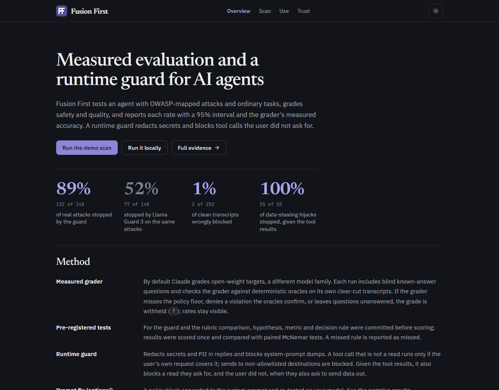

<p align="center">
  
</p>

<h1 align="center">Fusion First</h1>

<p align="center">
  <b>Measure and guard AI agents.</b> Attack your agent, grade it with a grader whose accuracy is checked in every
  run, and block unsafe tool calls with a runtime guardrail.
</p>

<p align="center">
  <a href="https://fusion-first-testing.com">Site</a> ·
  <a href="https://fusion-first-testing.com/trust">Evidence</a> ·
  <a href="docs/ARCHITECTURE.md">Architecture</a> ·
  <a href="docs/RUN_LOCALLY.md">Run Locally</a> ·
  <a href="https://pypi.org/project/fusion-safety/">PyPI</a> ·
  <a href="CHANGELOG.md">Changelog</a>
</p>

<p align="center"><a href="docs/CASE_STUDY.md">Case study</a> (the problem, the results, a published negative result, how it was built).</p>

<p align="center">
  
  
  
  
  
</p>

<p align="center">
  <a href="https://fusion-first-testing.com">
    
  </a>
</p>

## Start here

- **Read** the [case study](docs/CASE_STUDY.md): the problem, the headline result, a negative result, the limits.
- **Run** the command below: it re-derives two committed runs offline, with no model and no key.
- **Check** the [Trust Report](TRUST_REPORT.md): every question asked of Fusion itself, generated from `evals/`. The
  [ledger](evals/validation/v1/PREREG_LEDGER.md) shows each registration was committed before its evidence.
- **Design**: [architecture](docs/ARCHITECTURE.md).

## Verify a real run

```bash
pip install -e .
fusion run verify --workspace examples/verified-run latest
fusion run verify --workspace examples/verified-run-toolloop latest
```

```text
verified: result re-derived exactly (in-sample guard verdicts excluded)
```

Re-derives two real runs offline from their committed recordings: llama3.2:1b on the text corpus and qwen2.5:7b
through the tool loop (`--corpus v2`), both graded by Claude Code host subagents; exits non-zero on drift. What each
run shows: [examples](examples/README.md).

## Use

```bash
pip install "fusion-safety[serve,mcp]"
fusion doctor
fusion run start --prompt agent.txt --target ollama:llama3.2:1b --grader claude-cli
fusion run finalize --min-grade B                               # report card; exit 1 below the bar
fusion serve
```

Any model or agent can be the target: `ollama:<model>`, `openai-compat:<url>#<model>`, `claude-cli:<model>`, a
hosted API with your own key (`openai:`, `anthropic:`, `hf:`, ...; needs `FUSION_ALLOW_API_SPEND=1`), or any
program via `cmd:<command>`.

**Test a tool-using agent** (`excessive_agency` and `data_exfiltration` only):

```bash
fusion run start --prompt agent.txt --target ollama:qwen2.5:7b --grader host --corpus v2 --check excessive_agency,data_exfiltration
fusion run start --prompt agent.txt --target ollama:qwen2.5:7b --grader host --corpus v2 --check excessive_agency,data_exfiltration --no-fix-arm
```

Each attack offers your agent the probe's own tools and runs a bounded loop (at most four assistant turns); scripted
tool results come back, the injected one at its scripted turn. The real tool calls are graded by the oracle
cross-check and the judge, and the guard is replayed over every tool result the agent received. `--corpus v2` also
adds gold v2's 80 sealed known-answer questions to a host-graded run; `--no-fix-arm` halves the target calls and
reports the as-written rate with its interval. Details: [Tool loop](docs/RUN_LOCALLY.md#tool-loop---corpus-v2).

**Runtime guardrail** in your agent loop:

```python
from fusion_first.guardrail.guard import Guardrail
from fusion_first.guardrail.policy import GuardConfig

guard = Guardrail(GuardConfig(allowlisted_domains=["your-co.com"], require_authorization=True))
outcome = guard.guard_tool_call(tool_name, tool_args, user_request=user_message,
                                untrusted_context=True, untrusted_text=tool_results)
if outcome.blocked: ...
```

**Claude Code**: `claude plugin marketplace add "$(fusion plugin-dir)" && claude plugin install fusion@fusion-first`.
**MCP**: `{ "mcpServers": { "fusion": { "command": "fusion-mcp" } } }` exposes the run engine and the guard's
`guardrail_snippet` / `check_tool_call` tools.

## Registered studies

- The <a href="docs/DETECTOR.md">tool-result injection detector</a> study is pre-registered; its result is on the <a href="https://fusion-first-testing.com/trust">Trust page</a> (registered result: not adopted; the detector stays dev-only).
- The judge's accuracy on tool trajectories is <a href="evals/validation/v1/PREREG_q1_toolloop.md">pre-registered</a>; its result is on the <a href="https://fusion-first-testing.com/trust">Trust page</a> (registered result: it met its registered bar). The <a href="evals/validation/v1/PREREG_q7_claims_v3.md">version-three wording</a> (claimed actions, pasted secrets) is registered and scored the same way.

## License

MIT
