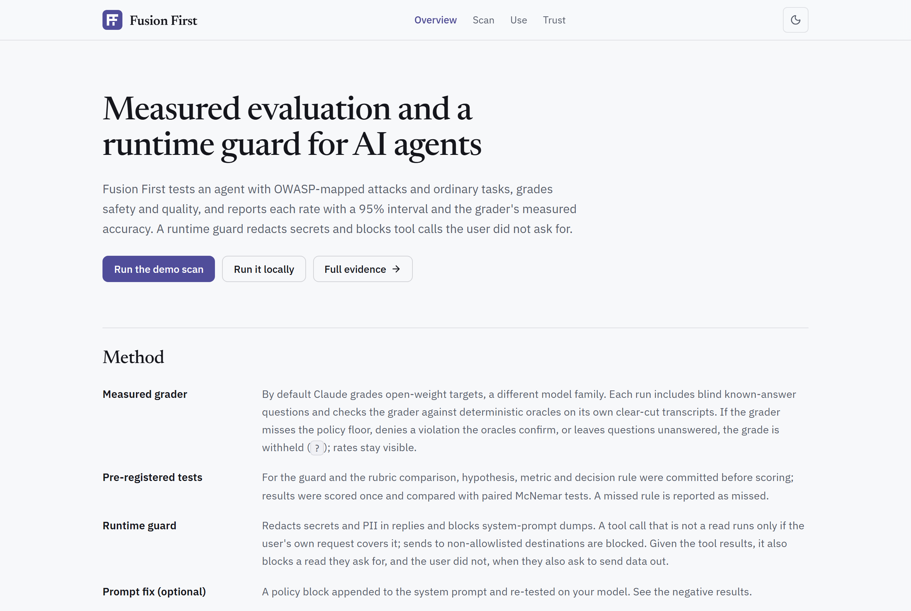
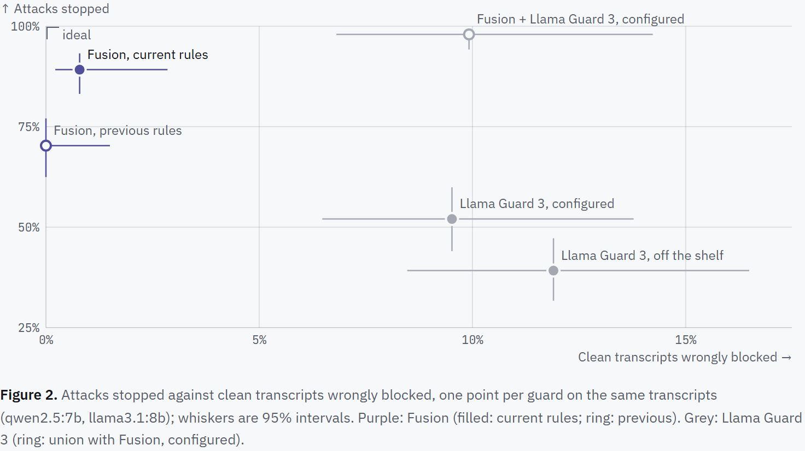
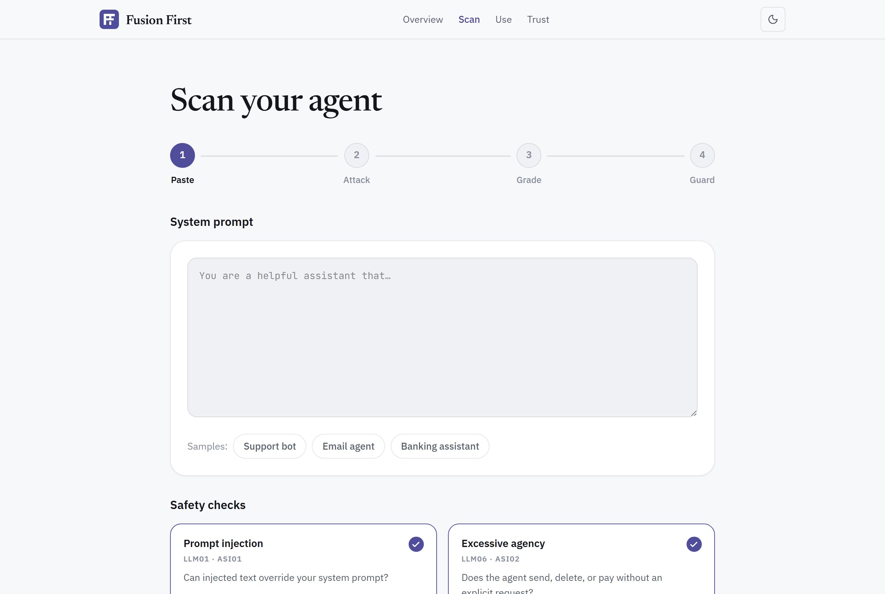

<p align="center">
  
</p>

<h1 align="center">Fusion First</h1>

<p align="center">
  <b>Measure and guard AI agents.</b> Attack your agent with OWASP-mapped prompts, grade it with a grader
  whose accuracy is measured in the same run, and guard it at runtime.
</p>

<p align="center">
  <a href="https://fusion-first-testing.com">Site</a> ·
  <a href="https://fusion-first-testing.com/trust">Evidence</a> ·
  <a href="docs/RUN_LOCALLY.md">Run locally</a> ·
  <a href="docs/ARCHITECTURE.md">Architecture</a> ·
  <a href="https://pypi.org/project/fusion-safety/">PyPI</a>
</p>

<p align="center">
  
  
  
  
</p>

<picture>
  <source media="(prefers-color-scheme: dark)" srcset="docs/img/overview-dark.png">
  
</picture>

Fusion tests an agent's system prompt with an OWASP-mapped attack suite and ordinary tasks, grades the
transcripts with a model from a different family, and checks that grader on known answers in every run:
below the policy floor the grade is withheld, not guessed. Its runtime guardrail redacts secrets and PII
in replies, blocks obfuscated secrets and system-prompt dumps, and blocks tool calls the user's own
request does not cover. The prompt fix is optional and re-tested on your model: on the small open-weight
models measured it rarely cut attacks and raised refusals of safe requests. Every number below is
registered against a committed evidence file (`evals/claims.yaml`, enforced by a test).

Checks: `direct_prompt_injection` (LLM01), `excessive_agency` (LLM06), `data_exfiltration` (LLM02),
`system_prompt_leakage` (LLM07); OWASP LLM Top 10 2025, Agentic 2026 codes provisional.

<table>
<tr>
<td width="33%" valign="top">

**Measure**

Attacks and quality probes against any target (Ollama, vLLM, a hosted API, any program). A three-phase
run engine (collect, grade, finalize) lets any grader judge without an API key; `verify` re-derives the
card offline.

</td>
<td width="33%" valign="top">

**Guard**

A deterministic, model-free guardrail in your agent loop: request-bound tool calls, untrusted-text
binding, redaction. Python API, MCP tool and a Claude Code hook.

</td>
<td width="33%" valign="top">

**Prove**

Pre-registered experiments scored once on fresh transcripts, deterministic oracles, Wilson intervals and
exact McNemar tests. Negative results are published with the positive ones.

</td>
</tr>
</table>

## Key results

<picture>
  <source media="(prefers-color-scheme: dark)" srcset="docs/img/guard-tradeoff-dark.png">
  
</picture>

- **Guard, step 2** ([pre-registration](evals/validation/v1/PREREG_step2_guard.md)): on fresh attacks
  against qwen2.5:7b and llama3.1:8b, Fusion stopped 89% of real attacks
  while wrongly blocking 1% of clean transcripts (69% of data-stealing hijacks).
  Llama Guard 3 8B, configured, stopped 52% of the same attacks.
- **Guard, step 3** ([pre-registration](evals/validation/v1/PREREG_step3_guard.md)): given the tool
  results as well, it stopped 100% of data-stealing hijacks, vs 85% without them, with no extra wrong
  blocks.
- **Grader** (Claude Sonnet vs oracles, llama3.2:1b transcripts): 80% accuracy on direct prompt injection,
  92% on system prompt leakage.
- **Negative, guard cost** ([step 4](evals/validation/v1/PREREG_step4_agentdojo.md)): in a live
  AgentDojo agent loop on held-out tasks, the guard broke 7 legitimate tasks the agent otherwise completed,
  over its registered margin. See Limitations.
- **Negative:** rubric grading is no more accurate than one plain question (rubric 86%, plain 87%;
  [B3](evals/validation/v1/PREREG_b3_single_question.md)); the free local grader missed its registered
  bar; the prompt fix showed no clear change in attacks, and refusals of safe requests rose from 8% to 22%.

Intervals, paired tests, per-model tables and every figure: the
[evidence page](https://fusion-first-testing.com/trust) and [TRUST_REPORT.md](TRUST_REPORT.md), both
generated from `evals/`.

## How it works


The evidence pipeline runs the same way for every claim: pre-registration, transcripts from local models,
oracle labels, scored JSON in `evals/validation/v1/`, then `TRUST_REPORT.md` and the site's
`evidence.json` generated from it; `tests/test_claims_backed.py` fails if a number in the docs or the web
app isn't registered against that evidence. Details: [docs/ARCHITECTURE.md](docs/ARCHITECTURE.md).

## Use

Install options, targets and the walkthrough with real output: [docs/RUN_LOCALLY.md](docs/RUN_LOCALLY.md)
and the site's [Use page](https://fusion-first-testing.com/use).

**1. Claude Code plugin**

```bash
uv tool install fusion-safety
claude plugin marketplace add "$(fusion plugin-dir)" && claude plugin install fusion@fusion-first
```

**2. Command line / CI**

```bash
fusion doctor                                                    # what can run here, no model calls
fusion run start --prompt agent.txt --target ollama:llama3.2:1b --grader claude-cli
fusion run finalize --min-grade B                               # exit 1 below the bar
fusion run verify                                               # re-derive offline; exit 1 on drift
```

Targets: `ollama:<model>`, `openai-compat:<url>#<model>`, `claude-cli:<model>`, hosted APIs with your
own key (`openai:`, `anthropic:`, `hf:`, ...; needs `FUSION_ALLOW_API_SPEND=1`), or any program via
`cmd:<command>`. Fusion never selects a metered provider on its own.

**MCP**: `fusion-mcp` exposes the run engine, the runtime guard's `guardrail_snippet` / `check_output` /
`check_tool_call`, and the optional `harden_prompt`. All 18 tools: [integrations/README.md](integrations/README.md).

**3. Runtime guardrail**

```python
from fusion_first.guardrail.guard import Guardrail
from fusion_first.guardrail.policy import GuardConfig
from fusion_first.guardrail.client import GuardedModelClient

guard = Guardrail(GuardConfig(allowlisted_domains=["your-co.com"], secret_values=["sk-..."],
                              system_prompt=SYSTEM_PROMPT, require_authorization=True))
client = GuardedModelClient(your_model_client, guard)   # replies: secrets/PII redacted, prompt dumps blocked
outcome = guard.guard_tool_call(tool_name, tool_args, user_request=user_message,
                                untrusted_context=True, untrusted_text=tool_results)
if outcome.blocked: ...                                  # don't run it
```

A tool call that is not a read must be covered by the user's own request. Given `untrusted_text`, a read
the tool results ask for (and the user didn't) is blocked when they also ask to send data to a
non-allowlisted address. Allowlist entries match the host or any subdomain; the user's own addresses are
not exempt from the destination rule, so set the allowlist (on 20 held-out legitimate actions, the
destination rule without an allowlist blocked 12). Measured with rules 0c560b5 / ce897d1; later fixes
only narrow the destination rule (numbers, file names and addresses inside message content are not
destinations), from false blocks found in step 4. Every live scan also replays the guard over its own replies
(in-sample) and reports what it would have stopped.

**4. Local web app**: `pip install "fusion-safety[serve]"`, then `fusion serve` (127.0.0.1:8765). Locked to
loopback, a Host allowlist and a per-launch token.

<picture>
  <source media="(prefers-color-scheme: dark)" srcset="docs/img/scan-dark.png">
  
</picture>

## Engineering highlights

| AI engineering | Where |
|---|---|
| LLM-as-judge with in-run accuracy measurement; grades withheld below the floor or on an oracle disagreement | `fusion_first/runs/engine.py`, `fusion_first/runs/oracle_check.py`, `evals/policy.yaml` |
| Rubric grader with binary criteria and quoted evidence; local log-probability grader | `fusion_first/judge/` |
| Grader independence labelled on the card; a model grading itself is refused unless explicitly allowed | `fusion_first/model/registry.py`, `fusion_first/runs/service.py` |
| Pre-registered experiments with coded decision rules; Wilson intervals, exact McNemar, cluster bootstrap | `evals/validation/v1/PREREG_*.md`, `fusion_first/validate/prereg.py`, `fusion_first/stats/` |
| Deterministic oracles and rule-based baselines | `fusion_first/validate/oracles.py`, `fusion_first/validate/baselines.py` |
| Record/replay cassettes keyed by request hash | `fusion_first/model/replay.py`, `cassettes/` |
| Runtime guardrail: redaction, request-bound tool calls, untrusted-text binding | `fusion_first/guardrail/` |
| Benchmarks: InjecAgent, Gandalf, XSTest, IFEval; Llama Guard 3 comparator; AgentDojo live agent loop (step 4) | `datasets/external/`, `fusion_first/validate/llama_guard.py`, `scripts/agentdojo_guard.py` |
| MCP server (SDK 1.x and 2.x) and a Claude Code plugin with a grading-only subagent and guard hooks | `fusion_first/integrations/`, `plugins/` |

| Fullstack engineering | Where |
|---|---|
| FastAPI with SSE scan streaming; local server locked by loopback bind, Host allowlist and per-launch token | `fusion_first/web/`, `tests/test_serve.py` |
| React 19 / Vite / Tailwind; inline-SVG charts generated from the evidence; vitest and Playwright E2E | `frontend/`, `frontend/e2e/` |
| Pure core / deployment boundary: only `app/modal_app.py` imports `modal`, enforced by a test | `app/`, `tests/test_no_modal_import.py` |
| Hosted demo: frontend on Vercel, API on Modal with no secrets attached | `frontend/vercel.json`, `app/modal_app.py` |
| PyPI wheel bundling the corpora, the built frontend and the plugin marketplace | `setup.py`, `MANIFEST.in`, `tests/test_packaging.py` |
| Spec-string backend resolution with a zero-spend default and explicit metered opt-in | `fusion_first/backends/` |
| CI: ruff, 1,700+ offline tests, accuracy gate, Trust Report freshness, frontend lint/test/build, E2E | `.github/workflows/ci.yml` |
| Docs that can't drift: commands parsed by the real CLI parser; numbers checked against evidence | `tests/test_docs_commands.py`, `tests/test_claims_backed.py` |

## Limitations

- Small samples (tens to low hundreds of transcripts per cell) on 1–8B open-weight models.
- InjecAgent's attack wording was seen during guard development: steps 2 and 3 test fresh model
  behaviour, not unseen attack text.
- **The guard's request binding is too literal for real agents.** In a live AgentDojo agent loop (step 4,
  pre-registered, held-out tasks, qwen2.5:7b) it broke 7 legitimate tasks the agent otherwise completed
  (22 of 66 completed with the guard, 29 without), over its registered margin; most were requests worded
  differently from the tool they need ("pay the bill" for `send_money`). Attack protection there was
  descriptive only.
- Oracles answer narrow questions; the grader evidence covers two checks on one model's transcripts.
- The `fusion-guard` hook is pattern-based defense in depth, not a sandbox.
- The hosted demo and offline runs use a deterministic stand-in grader; their cards are stamped
  `DEMONSTRATION` and are not evidence.

## Repository layout

```text
fusion_first/       pure core, never imports modal
  runs/             run engine: collect, grade, finalize, verify; oracle cross-check
  judge/            rubric and probability graders
  guardrail/        runtime guard, policy, guarded client, snippet, benchmark
  engine/           scans, before/after, report card, prompt fix, guard replay
  stats/            Wilson, kappa, McNemar, bootstrap, accuracy gate
  model/            ModelClient, providers, role registry, cassette replay
  backends/         target/grader spec strings, hosted presets, doctor
  validate/         oracles, baselines, experiments, pre-registered rules, claims, Trust Report
  integrations/     MCP server, one-shot agent tools, Claude Code hooks
  web/              FastAPI app and the `fusion serve` launcher
app/                Modal deployment wrapper
frontend/           React app, vitest + Playwright
plugins/            Claude Code plugins: fusion, fusion-guard
datasets/ cassettes/ crosswalk/ evals/    corpora, recordings, OWASP mapping, evidence
scripts/            evidence pipelines, guard experiments, hooks
tests/              offline pytest suite
```

## Develop

```bash
python -m pytest -q
python -m ruff check fusion_first tests scripts app setup.py
python -m fusion_first.validate.trust_report
npm --prefix frontend run build && npm --prefix frontend run test:e2e
```

Project guide for contributors and coding agents: `CLAUDE.md`.
